# 操作系统实验报告

## 实验基本信息

| 项目 | 内容 |
|---|---|
| 实验名称 | Lab2：物理内存初始化、连续页分配、对象分配与分页调试 |
| 小组 | NKU2026OS_NO.30 |
| 小组成员 | 2412267—高家铭、2414067—窦思微、2411520—谢国辉 |
| 实现与集成记录日期 | B：2026-10-24；A/C 集成：2026-10-25 |
| 报告重写及 DTB、测试有效性补证 | 2026-10-26 |
| 代码基线 | `main` 的 `328fd3a`；本轮保留现有内核实现，补充报告、调试脚本、故障注入验证和配图 |
| 仓库 | [NKU2026OS_NO.30](https://github.com/kighter123456/NKU2026OS_NO.30/tree/main/lab2) |
| 目录 | 源码 `lab2/code/`；报告 `lab2/report/`；当前文件 `lab2/report/report.md` |

### 小组分工

| 分工 | 代码与验证职责 | 报告职责及资料来源 |
|---|---|---|
| A：启动分页 | 高地址链接、启动页表、satp、TLB 刷新、启动映射适配 | 分页机制与启动问题；[A 原始记录](report-a.md) |
| B：物理内存管理，2414067—窦思微 | DTB、Page、PMM、First-Fit/Best-Fit/Buddy、简化 SLUB 及自测 | 初始化、分配算法、实现/测试提示词；[B 原始记录](report-b.md)、[prompt.md](prompt.md) |
| C：集成、测试、GDB、报告 | 核查 A/B 交付，维护共享契约、启动检查与集成工具，完成 QEMU 源码双 GDB | 执行流、测试依据、调试现场、交叉核查与整合；[核查记录](review-ab.md)、[AI 协作记录](ai-collaboration.md) |

成员名单沿用小组已有报告，工作内容按本次《Lab分工.md》的 A/B/C 角色归档；现有 Lab2 材料只明确标注了 B 的学号姓名，不额外推定 A/C 的个人对应关系。A/B 历史记录保留，主报告以当前整合代码和实际日志为准。

本报告遵循仓库《实验报告模板.md》的一级框架：**实验目的、实验环境、整体逻辑、实验内容与实现、测试与验证、总结与收获**。实现部分按照指导书的物理内存初始化、内存范围思考题、First-Fit、Best-Fit、Buddy、SLUB 顺序展开，再说明启动分页支持和 C 的调试工作。

阅读导航：[实验目的](#一实验目的) · [实验环境](#二实验环境) · [整体逻辑](#三实验整体逻辑分析) · [实现与练习](#四实验内容与实现) · [测试与验证](#五测试与验证) · [总结与收获](#六实验总结与收获)。DTB 详解见 4.1，思考题演示见 4.2，测试改动及有效性见 5.1～5.8。

**交付范围：**已有证据显示，35 个自建功能场景、9 个启动 GDB 场景及 QEMU 源码调试通过；本次新增 3 个容量的 DTB 专项调试和 4 个故障注入反向验证，也均达到预期。课程原始 `basic_check()/best_fit_check()` 尚未取得，分工材料中的通用 map/unmap/query API 尚未交付。因此下文的“通过”均指明确列出的自建验证，不表示已经通过课程原评分或实现全部动态虚拟内存功能。

## 一、实验目的

1. 从启动协议提供的信息中获取 RAM 范围，理解“物理内存被发现”与“物理内存被分配器管理”的区别。
2. 建立物理页描述符数组，正确排除 OpenSBI、内核镜像、描述符和不完整页，保证初始化后的空闲页可以安全交付分配器。
3. 区分 VA、PA、PFN、Page 指针和页表项，理解固定高地址映射怎样支持内核访问物理页。
4. 理解 First-Fit 的选块、拆分、回收和合并，实现可切换的 Best-Fit，并分析两种策略的碎片与扫描开销。
5. 通过 Buddy 体会按二次幂管理页面，通过简化 SLUB 体会页分配和对象分配的两层结构。
6. 用客户机 GDB 观察真实启动状态，用宿主 GDB 观察 QEMU 的查表及软件 TLB，解释 Sv39 大页为何可能只查询一级。
7. 为 AI 生成的实现建立具体规格及独立检查依据；通过正常场景、非法调用、数据隔离和故障注入，说明测试的合理性与有效性。

## 二、实验环境

### 2.1 当前整合验证环境

| 项目 | 版本或配置 | 作用 |
|---|---|---|
| 宿主 | Windows，WSL2，x86-64 | 编辑、Git 和 Linux 开发环境 |
| Linux | Ubuntu 22.04.1，WSL 内核 6.6.87.2 | 执行编译、QEMU、Python 与 GDB |
| RISC-V GCC | `riscv64-unknown-elf-gcc` 10.2.0 | 交叉编译 RV64 内核 |
| binutils / Make | 2.35.1 / 4.3 | 链接、反汇编和构建 |
| Python | 3.10.6 | runner、集成验证、调试协调 |
| 系统 QEMU / OpenSBI | QEMU 6.2.0 / OpenSBI 0.9 | `virt` 单 hart 平台及固件 |
| 客户机 GDB / 宿主 GDB | gdb-multiarch 12.1 / 原生 GDB 12.1 | 分别调试 RV64 内核和 x86-64 QEMU |
| QEMU 源码调试版 | 上游 6.2.0，`--enable-debug`，未剥离 | 观察 MMU 和软件 TLB 源码分支 |
| 内存矩阵 | 64、128、256 MiB | 验证实际发现、管理上限和不同布局 |
| 编译选项 | `-mcmodel=medany -O2 -g -Wall -Werror -nostdlib` 等 | 高地址内核、优化构建和调试符号 |

版本证据见 [environment.txt](../code/evidence/integration/boot-best_fit-128M/environment.txt)。B 的历史独立验证使用 Ubuntu 24.04、GCC 13.2、QEMU 8.2，A 的适配记录涉及 QEMU 10.2；这些是不同阶段的环境，不将历史故障写成当前 6.2 环境重新发生过的现象。指导书的源码调试示例使用 QEMU 4.1.1，本实验以实际 6.2.0 的函数和行号解释。

### 2.2 AI 工具与使用边界

| 范围 | AI 编程工具 | 底层模型 | 可确认的使用方式 |
|---|---|---|---|
| 当前 C 集成及报告会话 | Codex 桌面应用 | GPT-6 系列 | 读代码、修改集成工具、执行 WSL/GDB、整理报告与配图 |
| A 的历史工作 | 原始记录描述由 AI 辅助 | 历史文件未记录精确型号 | 用户确定启动分页范围，AI 生成和验证改动 |
| B 的历史工作 | 原始记录及实施前 prompt 可查 | 历史文件未记录精确型号 | 按 P1～P5 规格实现分配器和自测 |

本报告没有把当前工具型号倒填成所有成员过去使用的工具。实现提示词与历史记录分别来自 [prompt.md](prompt.md) 和 [ai-collaboration.md](ai-collaboration.md)；本次新增的 DTB 和故障注入操作有独立脚本、实际执行日志。

### 2.3 路径与命令上下文

PowerShell 进入 WSL：

```powershell
wsl -d Ubuntu --cd "E:\桌面\OSLab\lab2\code"
```

后文 Bash 命令默认在 `/mnt/e/桌面/OSLab/lab2/code` 执行。报告内链接相对于 `lab2/report/`。GDB 代码块只能在 GDB 提示符下执行。`bin/<PMM>/<TEST_CASE>/kernel` 为带符号 ELF，`ucore.img` 为启动镜像；两者应来自同一构建配置。

## 三、实验整体逻辑分析

### 3.1 本章节的逻辑主线

本章围绕“让内核知道哪些物理页存在、哪些可以使用、怎样分出去、如何确认没有分错”展开。启动分页解决内核如何访问高虚拟地址；DTB 解决 RAM 来源；Page 数组解决状态记录；PMM 解决页所有权；SLUB 解决小对象粒度；测试和 GDB 负责检查各层是否满足契约。

这几层不能互相替代。`alloc_pages()` 返回一组描述符，意味着获得对应物理页的使用权，不会自动创建页表项；本实验能立即访问分配的页，是因为启动时已经建立了覆盖该范围的高直接映射。反过来，某地址有启动映射，也不说明它可被分配：固件、内核和元数据仍然必须预留。

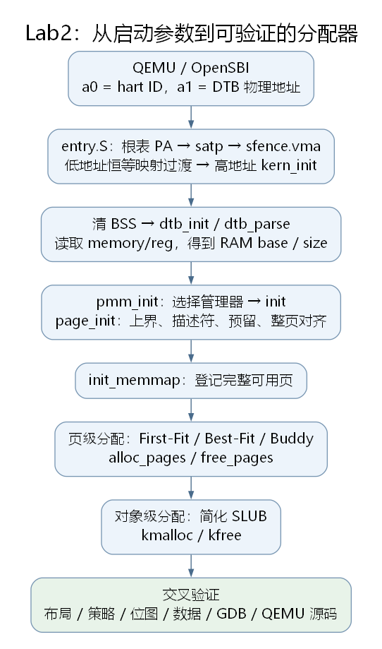

图1依据 [entry.S](../code/kern/init/entry.S)、[init.c](../code/kern/init/init.c) 和 [pmm.c](../code/kern/mm/pmm.c) 绘制；可编辑源文件为 [01-execution.dot](images/01-execution.dot)。

### 3.2 功能的逐步实现及先后依赖

| 顺序 | 当前执行内容 | 为什么放在这里 |
|---|---|---|
| 1 | QEMU 装载，OpenSBI 传入 a0/a1 | 取得 hart ID 和 DTB 地址 |
| 2 | 物理入口设置启动页表、satp、栈，跳到高地址 C 入口 | 链接后的 C 地址需要有效映射 |
| 3 | `kern_init` 清 BSS | 初始化全局静态状态；此前不把启动参数保存在会被清零的全局变量里 |
| 4 | `dtb_init` 解析 RAM | Page 数量和布局依赖真实 RAM 范围 |
| 5 | `pmm_init` 选择后端，调用后端 `init` | 先建立管理器内部空状态 |
| 6 | `page_init` 建立描述符、预留占用，调用 `init_memmap` | 只有合法完整页才能进入空闲结构 |
| 7 | 页分配器及 SLUB 自测 | 页级接口稳定后，才能检验对象级分配 |
| 8 | 内核进入空循环 | 当前没有调度器；停止输出并非崩溃 |

指导书用 `pmm_init → init_pmm_manager → page_init → init_memmap` 概括初始化。本实现把 DTB 解析提前到 `pmm_init` 之前，将管理器选择直接写在 `pmm_init` 中，依赖关系仍是“先发现 RAM，再建立描述符，先初始化管理器，再登记空闲页”。不能机械地把指导书中的函数名当成当前代码中必然存在的独立函数。

### 3.3 项目组成与层间契约

| 文件/模块 | 核心内容 | 与下一层的约定 |
|---|---|---|
| [entry.S](../code/kern/init/entry.S)、[kernel.ld](../code/tools/kernel.ld) | 装载与链接地址、启动根表、栈、satp | a0/a1 保留，C 在高地址运行 |
| [dtb.c](../code/kern/driver/dtb.c)、[dtb.h](../code/kern/driver/dtb.h) | 有边界的 FDT 解析 | 输出连续 RAM 的 base/size；无效时失败 |
| [memlayout.h](../code/kern/mm/memlayout.h)、[pmm.h](../code/kern/mm/pmm.h) | 唯一 Page 定义、管理器接口、地址转换 | PFN、PA、KVA、Page 的语义一致 |
| [pmm.c](../code/kern/mm/pmm.c) | 布局及所有权共用检查 | 后端只操作已登记的完整页 |
| [default_pmm.c](../code/kern/mm/default_pmm.c)、[best_fit_pmm.c](../code/kern/mm/best_fit_pmm.c) | 地址有序链表、Fit 策略 | `property` 表示块头页数 |
| [buddy_pmm.c](../code/kern/mm/buddy_pmm.c) | 分阶链表、对齐、拆合 | `property` 表示阶数，计数按实际跨度 |
| [slub.c](../code/kern/mm/slub.c) | 页内对象、大对象路径 | 通过公共 PMM 获取和归还页面 |
| [selftest.c](../code/kern/mm/selftest.c) | 布局、策略、位图、数据和负面场景 | 失败触发断言，runner 判断是否预期 |
| [run_tests.py](../code/tools/run_tests.py)、[verify.py](../code/tools/verify.py) | 功能判定、启动 GDB 判定 | 有原始日志及非零失败退出码 |
| [qemu_mmu_debug.py](../code/tools/qemu_mmu_debug.py)、[qemu_host.py](../code/tools/qemu_host.py) | 客户机与宿主协调 | 用真实 CPU 访问观察源码分支 |

## 四、实验内容与实现

### 4.1 功能模块一：物理内存探测与页描述符初始化

**负责人：B；C 负责分页后的契约核查与专项调试。**

#### 功能、接口与规格

```c
void dtb_init(uintptr_t hartid, uintptr_t dtb_pa);
int dtb_parse(const void *blob, size_t available, struct memory_info *out);
uintptr_t get_memory_base(void);
size_t get_memory_size(void);
void pmm_init(void);
static void page_init(void);
uintptr_t page2pa(const struct Page *p);
struct Page *pa2page(uintptr_t pa);
```

`dtb_init` 把启动参数转换为可读 DTB，`dtb_parse` 校验并提取 RAM 信息。`page_init` 不自行扫描所有物理地址，而是消费已解析的 base/size，计算管理范围和元数据布局，最后通过管理器的 `init_memmap` 登记空闲页。

本模块的规格包含六个不变量：内存信息无效不能继续；管理范围不能超过 RAM 或 PHYSTOP；内核及描述符不能被当成空闲页；空闲范围必须整页对齐；`npage` 是绝对 PFN 上界；空区间不调用 `init_memmap`。这些约束先确定，再决定地址计算和检查方式。

#### DTB 到底是什么，为什么能获得内存大小

DTB 是 Flattened Device Tree 的二进制表示，描述启动平台的硬件资源。本平台启动时 a0 保存 hart ID，a1 保存 DTB **物理地址**。a1 不是内存容量，也不是描述符指针。内核从设备树的 `memory` 节点读取 `reg`，再根据编码规则得到 RAM 起始地址和大小。

分页前，CPU 从物理 `0x80200000` 执行；分页后，`dtb_pa` 参数仍是物理数值，不能因为变量进入 C 函数就自动变成高虚拟指针。当前实现用：

```text
DTB_KVA = DTB_PA + KERNEL_VA_PA_OFFSET
KERNEL_VA_PA_OFFSET = 0xffffffff40000000
```

这一转换使用已经建立的 1 GiB 高直接映射。此时不能调用 PMM 的 `KADDR` 作为通用入口：`managed_end` 尚未初始化，而且 256 MiB 时 DTB 位于当前受管的前 128 MiB 之外。**启动映射覆盖范围、实际 RAM 范围、PMM 受管范围是三个不同集合。**

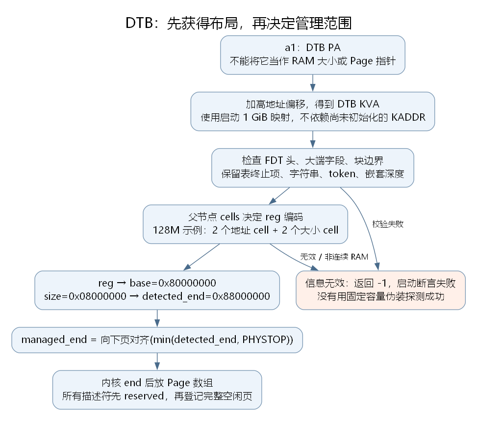

图2对应 [dtb.c](../code/kern/driver/dtb.c) 和 `page_init`；[可编辑图源](images/02-dtb-flow.dot)。

#### FDT 二进制结构与大端解析

FDT 头部为 40 字节，当前实现读取下列大端 32 位字段：

| 头内偏移 | 字段 | 用途 |
|---|---|---|
| 0x00 | magic | 必须为 `0xd00dfeed` |
| 0x04 | totalsize | 整个 blob 的有效大小 |
| 0x08 / 0x0c | off_dt_struct / off_dt_strings | 结构块和属性名字符串块的位置 |
| 0x10 | off_mem_rsvmap | 保留表位置 |
| 0x14 / 0x18 | version / last_comp_version | 校验版本兼容条件 |
| 0x1c | boot_cpuid_phys | 启动 CPU 信息；本模块不据此计算 RAM |
| 0x20 / 0x24 | size_dt_strings / size_dt_struct | 两个块的长度 |

RV64 客户机使用小端，但 FDT 字段使用大端。因此 `be32` 按字节移位组合，不能把 blob 强转成 `uint32_t *` 后直接取数。例如魔数的真实字节是 `d0 0d fe ed`，按 FDT 规则解释才得到 `0xd00dfeed`。

结构块用 token 描述节点和属性：BEGIN_NODE 压栈，END_NODE 出栈，PROP 提取长度、属性名偏移和值，NOP 跳过，END 结束。节点名和值按 4 字节边界推进；属性名通过 strings 块定位，不能把 nameoff 当成绝对地址。

`reg` 的地址和长度各占几个 32 位 cell，由**父节点**的 `#address-cells` 和 `#size-cells` 决定。当前 QEMU 的 RAM 节点使用 2+2 个 cell，128 MiB 的实际数据为：

```text
地址 cell：00 00 00 00  80 00 00 00 → base = 0x0000000080000000
大小 cell：00 00 00 00  08 00 00 00 → size = 0x0000000008000000
终点：base + size = 0x88000000
```

测试夹具还覆盖“2 个地址 cell、默认 1 个大小 cell”的合法输入。支持 1/2-cell 字段不等于已经完整支持任意设备树；当前解析器特意限制连续 RAM，额外 bank 只有按顺序紧邻时才合并，不连续布局返回失败。

#### 解析器怎样限制越界及错误输入

| 检查位置 | 处理方式 | 防止的问题 |
|---|---|---|
| 初始头 | 检查非空、至少 40 字节、魔数、total 与 available | 无效指针参数、截断头及虚假总长 |
| 块范围 | `offset <= total && length <= total-offset` | 使用减法约束，避免 offset+length 溢出绕过边界 |
| 块关系和对齐 | struct/strings 不重叠，结构块 4 字节、保留表 8 字节对齐 | 误读块或不合法布局 |
| 保留表 | 有界扫描，必须存在全零终止项 | 读取超出 blob；但并未把所有保留项转成 PMM 排除区 |
| 节点栈 | 最多 16 层，检查节点闭合、根节点与结束 token | 栈溢出及不完整树 |
| 字符串和属性 | 确认终止符、长度、nameoff 和值范围 | strlen/strcmp 或 reg 解码越界 |
| memory/reg | cells 只能 1 或 2，长度需整组，size 非零，base+size 不溢出 | 错误内存边界或回绕 |

`dtb_init` 先把 a1 限制在平台预期地址和对齐范围内，最多给解析器 2 MiB 的可用长度。这个上限是软件解析边界，**不能证明任意传入物理地址都可安全读取**：仍依赖启动方提供有效、可读 DTB 的平台前提。

另外，当前代码检查 FDT 保留表终止项，却没有通用解析并扣除所有 reservation 和 `/reserved-memory`。当前 QEMU 固件低端、内核和描述符由布局规则预留；这不等于支持真实硬件上的任意保留洞。本报告没有把这一限制写成已完成的能力。

#### page_init 的地址计算与预留顺序

```text
detected_end = get_memory_base() + get_memory_size()
managed_end = ROUNDDOWN(min(detected_end, PHYSTOP), PGSIZE)
nbase       = DRAM_BASE / PGSIZE = 0x80000
npage       = managed_end / PGSIZE
count       = npage - nbase
desc_va     = ROUNDUP((uintptr_t)end, PGSIZE)
desc_pa     = desc_va - va_pa_offset
desc_end    = desc_pa + count * sizeof(struct Page)
free_begin  = ROUNDUP(desc_end, PGSIZE)
```

`end` 是链接符号，位于内核所有静态存储之后，包括 BSS 中的自测数组。先验证描述符放得下，再对数组清零；之后把全部描述符置为 reserved，只有 `[free_begin, managed_end)` 对应的完整页进入分配器。这种“先全部预留，再释放已确认可用页”的顺序避免遗漏某区域时默认放行。

描述符覆盖 `[DRAM_BASE, managed_end)` 的每个物理页，包含已经保留的页。因而 `count` 按整个受管范围算，不能只按 FREE 页数算。数组本身占用 RAM，也要从 FREE 中扣除，否则后续分配会覆盖页状态记录。

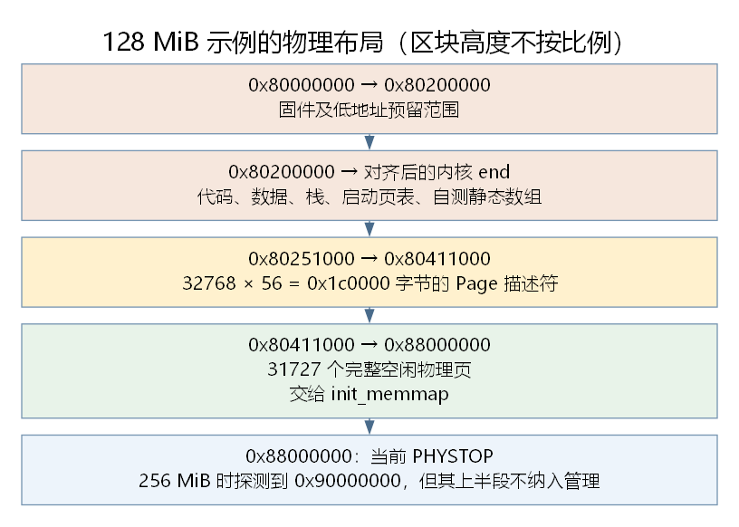

图3为本轮 Best-Fit/128 MiB 构建实例，非按比例示意；依据 [实际 DTB 调试日志](evidence/dtb-128M/gdb.log) 绘制，[图源](images/03-memory-layout.dot)。

以该构建为例：`count=32768`，`sizeof(Page)=56`，描述符占 `32768×56=0x1c0000` 字节，即 1.75 MiB；数组 PA 为 `[0x80251000,0x80411000)`，FREE 为 `[0x80411000,0x88000000)`，共 31727 页。描述符地址随内核大小变化，验证程序应从符号和运行值计算，不能硬编码这两个端点。

#### Page、PFN、PA、KVA 与链表节点

```text
Page 指针 p → (p-pages) 为数组下标 → 加 nbase 得到 PFN
PFN × 4096 → 物理页起始 PA → 加高映射偏移得到访问页内容的 KVA
```

当前 RV64 布局中 Page 为 56 字节，包含 ref、flags、property、page_link、alloc_span、requested。`p+1` 移动 56 字节的元数据，描述的是下一张 4096 字节物理页；不能把 Page 指针当成页内容地址。

| 接口/字段 | 含义与约束 |
|---|---|
| `page2pa(p)` | 验证指针对齐及数组范围，返回 `(p-pages+nbase)*4096` |
| `pa2page(pa)` | 验证受管 PA，按页号返回描述符；页内偏移被舍弃 |
| `PADDR/KADDR` | 在本项目受管直接映射范围内做 KVA/PA 换算；不是通用多级页表查询 |
| `page_link` | Page 内嵌的双向链表节点，prev/next 指向节点 |
| `le2page` | 用 `offsetof(Page,page_link)` 从节点地址减回结构起点 |
| `property` | Fit 块头的页数；Buddy 块头的 order，order=0 是合法阶 |
| `alloc_span/requested` | 已分配头记录实际占用与原始请求；Buddy 二者可能不同 |

链表带哨兵并循环，空表时 head.next=head.prev=head，不是 NULL。哨兵不嵌在 Page 中，不能对它做 `le2page`。`list_del` 只摘节点，不会自动修改空闲页计数或归还物理内存。

#### 最终提示词与可核实迭代

以下按 B 的 P1 整理当前规格；P1 历史原文中的 Bare 阶段约束保留在 [prompt.md](prompt.md)。

```text
[上下文] 阅读 init.c、dtb.h、memlayout.h、pmm.h、链接符号 end 和打印/对齐设施。
[目标] 从 a1 的 DTB 解析连续 RAM，建立 Page 数组并交付完整空闲页。
[规格] 检查 FDT 大端字段、总长、块边界、token、父 cells、溢出与非法布局；
信息无效必须终止，不用固定容量兜底。npage 是绝对 PFN 上界；
管理终点取 RAM 终点与 PHYSTOP 的较小值。预留固件、内核、描述符及非整页。
[接口] 沿用唯一 Page 和 pmm_manager；PMM 不设置 satp，不自行建立映射。
[验收] 打印发现/管理/空闲范围；验证地址往返、描述符开销和容量变化；
没有完整可用页不得调用 init_memmap。分页集成后由 A/C 确认高直接映射契约。
```

历史 B 阶段先在 Bare 下独立验证，A 接入 Sv39 后，所有权和数组算法沿用，地址契约变为高直接映射。C 重点复核了 a0/a1 在清 BSS 之前不依赖全局保存，以及 DTB 不误走受管 `KADDR`。本次补做专项 GDB，不虚构此前有多少轮代码生成。

#### DTB 专项 GDB：从输入字节跟到受管页

本次新增 [dtb.gdb](tools/dtb.gdb) 和 [capture_dtb.py](tools/capture_dtb.py)。脚本在三个独立 QEMU 进程中运行，输出到 `report/evidence/dtb-64M/`、`dtb-128M/`、`dtb-256M/`，不覆盖原有 selftest 或 integration 日志。

```bash
python3 ../report/tools/capture_dtb.py
```

手动观察可在两个 Ubuntu 终端分别 `make debug` 和 `make gdb`，然后按阶段执行：

```gdb
thbreak *0x80200000
continue
info registers pc a0 a1 satp
thbreak dtb_init
continue
info args
info registers pc satp
set $dtb_kva = (unsigned long)dtb_pa + 0xffffffff40000000
x/40bx $dtb_kva
thbreak dtb_parse
continue
info args
finish
thbreak run_selftests
continue
p/x nbase
p/x npage
p sizeof(struct Page)
p/x pages
p/x free_begin
p/x managed_end
detach
quit
```

本轮 128 MiB 的真实现场如下：

| 阶段 | 观测值 | 说明 |
|---|---|---|
| 物理入口 | a1=`0x87000000`，satp=0 | 固件参数是 DTB PA |
| dtb_init | satp=`0x8000000000080207` | 已在 Sv39 下运行，参数 PA 保持不变 |
| 解析指针 | blob=`0xffffffffc7000000` | 等于 PA 加高映射偏移 |
| FDT 头 | total=4898，version=17，last_comp=16 | 头部与 2 MiB 解析上限一致 |
| 块位置 | struct=0x38，strings=0xe18，reservations=0x28 | 可按偏移逐块交叉核对 |
| RAM 节点 | memory@80000000；父 cells=2+2；reg 长度=16 | 不是把 reg 固定当一对 32 位数 |
| dtb_parse 返回 | 0；base=0x80000000，size=0x08000000 | 内核实际解析成功 |
| PMM 完成 | npage=0x88000，pages=0xffffffffc0251000 | 描述符数量与布局正确 |

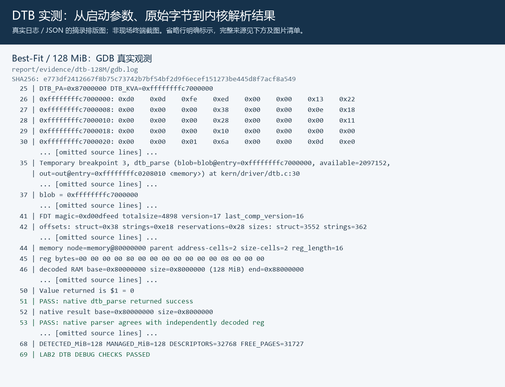

图4由 [dtb-128M/gdb.log](evidence/dtb-128M/gdb.log) 的原始行摘录排版生成，带行号和摘要；它是日志配图，不冒充现场终端截图。专项脚本还在宿主 GDB Python 中独立解码所读 blob 的 reg，并与**内核真正执行 dtb_parse 返回的 memory_info** 比较。独立解码是观察手段，不是替换内核解析器运行。

完成 GDB 观察后，脚本继续等待全部正常自测成功。因此只停到 `run_selftests`、打印一句成功而后续崩溃的情况，不能通过这次专项验证。

### 4.2 Challenge：不知道硬件内存范围时如何获得

**负责人：B 思考，C 补充演示与边界核查。**

不知道 RAM 大小，不意味着只能向任意地址写读。应首先使用平台启动协议或固件提供的内存布局：本平台用 DTB，UEFI 平台可用 GetMemoryMap，传统 x86 可用 E820。获得 RAM 区段后还要剔除固件、设备、内核及其他保留区域，并按页对齐后交付分配器。

直接写读未知地址可能访问 MMIO、改变设备状态或触发总线错误；读回相同数据也不必然证明整个区间都是独立 RAM。可靠探测必须结合平台规范与异常处理。本项目展示的是 QEMU/DTB 路径，没有实现跨平台通用探测。

**现场演示**在 `lab2/code` 依次运行，每次看到自测结束后按 Ctrl+A，再按 X 退出：

```bash
make PMM=best_fit MEMORY=64M qemu
make PMM=best_fit MEMORY=128M qemu
make PMM=best_fit MEMORY=256M qemu
```

| 配置 | DTB 发现终点 | 管理终点 | 本次专项 GDB 的 FREE 页数 |
|---|---|---|---|
| 64 MiB | 0x84000000 | 0x84000000 | 15567 |
| 128 MiB | 0x88000000 | 0x88000000 | 31727 |
| 256 MiB | 0x90000000 | 0x88000000 | 31727 |

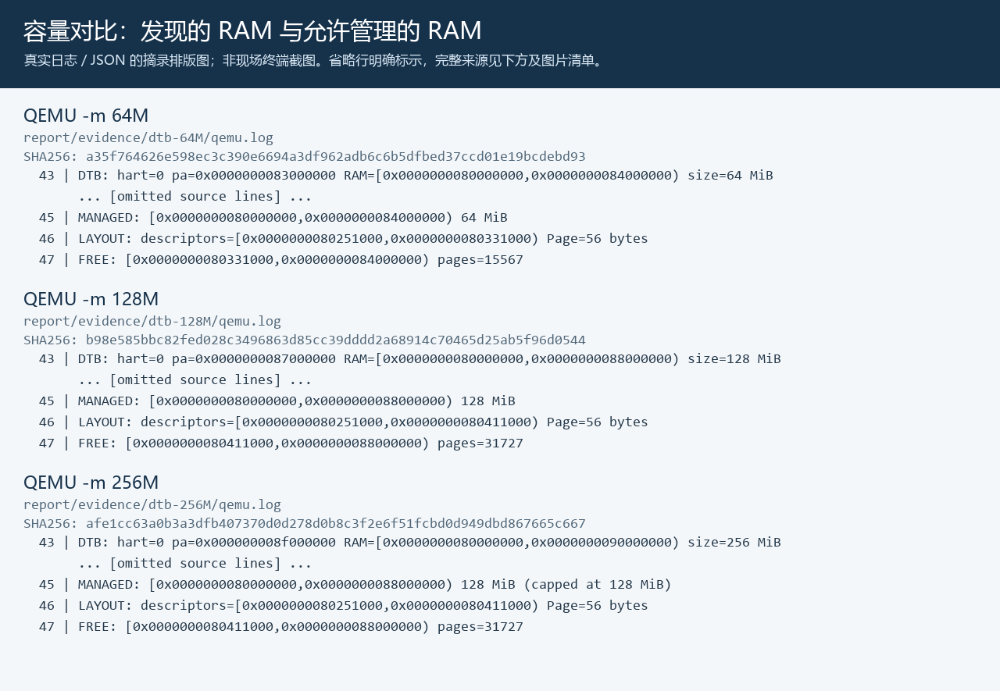

图5来自本次三个容量的 [专项调试目录](evidence/README.md)。256 MiB 的发现值增加，但受 PHYSTOP 限制仍只管理 128 MiB；说明 `get_memory_size()` 的来源是设备树，而上限是本实现的管理策略。FREE 页数还取决于内核与描述符大小，不能只用总容量直接除以 4096。

本思考题的结论有两层：**发现资源依赖启动平台提供的可靠描述，决定哪些资源可分配还要靠内核的预留和布局策略。**演示覆盖当前连续 RAM 平台，保留区通用处理仍属后续工作。

### 4.3 功能模块二·任务一：理解 First-Fit

**负责人：B。**

#### 核心函数及指导书名称对照

| 指导书名称 | 当前实现 | 职责 |
|---|---|---|
| default_init | `fit_init` | 初始化哨兵和空闲计数 |
| default_init_memmap | `fit_init_memmap` | 校验 reserved 范围，登记空闲块 |
| default_alloc_pages | `first_alloc → fit_alloc_pages(n,0)` | 选择第一个足够大的块 |
| default_free_pages | `fit_free_pages`，共用 `insert_block` | 完整校验、释放、地址插入及前后合并 |

共享实现位于 [default_pmm.c](../code/kern/mm/default_pmm.c)。空闲链表按 Page 地址递增，只有空闲块头挂链并设置 PageProperty，property 保存块长。非头的空闲页不应被误当成独立空闲块。

#### 初始化、分配与回收的完整过程

初始化先把链表设成空循环，空闲数置零。`init_memmap(base,n)` 检查范围、检查每页原为 reserved，清除保留状态，将连续 n 页登记成块，并增加空闲计数。地址有序是为后续合并服务，并不意味着按块大小排序。

分配 n 页时，先判断总空闲数，再扫描链表。遇到首个 property≥n 的块就选中并摘链；若块长 L>n，`chosen+n` 成为余块头，长度 L−n。随后标记前 n 页已分配，记录 span/request，空闲数减 n。找不到连续足够块返回 NULL，不能只因总空闲数足够就拼接不连续页。

释放先调用共用所有权检查，**确认整个区间都合法后再改变状态**。之后按地址插入并检查：

```text
向前合并条件：prev + prev->property == base
向后合并条件：base + base->property == next
```

向前合并后应把当前头改成 prev，再检查向后合并。被吞并的旧头要摘链、清除块头标记。每次只把新归还的 n 页加回计数，合并不会额外创造空闲页。当前 Fit 允许分批释放已分配区间，但部分释放之后，原头上的完整分配跨度信息不再保证有效。

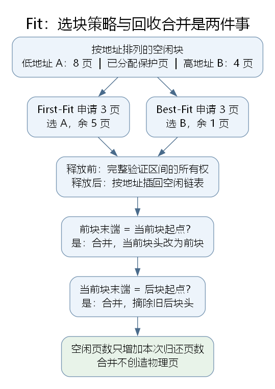

[图源](images/04-allocation.dot)显示选块策略不同，但释放时都依赖地址顺序及物理连续性。链表相邻只说明中间没有另一个**空闲块**，不说明中间没有已分配页。

#### 思考题：原有 First-Fit 有何改进空间

有。链表每次从头找会反复扫描，Next-Fit 可用游标分散搜索；分桶或树可加速找块，但要维护额外索引。也可以限制过小余块或调整分裂策略，但这会引入内部浪费，需要结合请求分布评估。及时合并能缓解外部碎片，却无法把仍被占用页隔开的空闲块合成连续物理区间。

本实验只验证正确性，没有测量搜索长度、延迟或不同工作负载下的碎片率，因此不把“可能改进”写成已有性能提升。

#### 最终提示词、实现过程与结果

```text
[任务] 分析并实现 First-Fit：地址有序空闲链表，块头记录长度。
[规格] 申请选择第一个够大的块，正确拆分；释放先验证完整范围，
允许分批归还，合并物理连续的前后块；失败不改状态，计数以页为单位。
[错误契约] 0 页和非法释放触发断言，合法请求但资源不足返回 NULL。
[验证] 隔离空闲块，检查精确匹配、拆分、碎片失败和三种合并方向；
不要只测试最终空闲页数，要检查选择地址和块头 property。
```

该提示词由历史 P2 整理。现有结果表明 Fit 的策略差异、部分释放、前/后/双向合并均通过；本次没有为报告虚构新的算法迭代。具体检查在 `fit_check`，故障发现依据见第五节。

### 4.4 功能模块二·任务二：实现 Best-Fit

**负责人：B；C 核查注册、测试入口和原测试缺项。**

#### 核心接口、策略和注册

```c
struct Page *fit_alloc_pages(size_t n, bool best);
static struct Page *best_alloc(size_t n);
const struct pmm_manager best_fit_pmm_manager;
```

[best_fit_pmm.c](../code/kern/mm/best_fit_pmm.c) 用 `best_alloc` 调用共用 Fit 逻辑，并注册 init、init_memmap、alloc/free、nr_free_pages、check。`pmm_init` 根据构建参数选择函数表，默认 `PMM=best_fit`。运行时名称只是辅助证据，策略测试才证明它确实选了不同的块。

Best-Fit 遍历满足请求的块，保留目前最小者；遇到精确匹配可提前结束。同长块因为地址有序且只有更小才替换，所以选择低地址。拆分、回收和合并仍维护同一地址有序结构。该设计减少重复代码，同时意味着若共用合并逻辑有错，两种 Fit 都可能受影响，需要外部数据和状态检查补充。

#### 最终提示词

```text
[上下文] 阅读 pmm_manager 契约和 First-Fit 的空闲块语义。
[实现] 完整定义 best_fit_pmm_manager，选最小足够块，同长选低地址；
可复用共用链表维护，不能只把 First-Fit 改名。默认构建选择 Best-Fit。
[状态] 拆分/合并保持地址顺序与块头标记；失败不改变计数和链表。
[测试] 隔离低地址 8 页和高地址 4 页，申请 3 页，必须选择后者；
再测精确匹配、碎片导致失败和恢复。不得修改课程原测试迁就实现。
[资料限制] 当前未取得 basic_check/best_fit_check，新增检查明确标为自建；
取得原件后保持内容不变接入，不能宣称已通过尚未运行的原测试。
```

这是 [P3](prompt.md#p3best-fit-实现) 的规格整理，保留了原测试的不可替代性。指导书明确要求保留所给的两个测试函数；当前基础环境未提供这两个函数，现有测试不是它们的同名改写版。这一缺口不因新增测试多而自动消失。

#### 实现迭代与思考题

B 已交付完整管理器，A/C 集成后将执行状态和 runner 识别由历史 Bare 更新为 Sv39。C 本次又在临时副本把 `fit_alloc_pages(n,1)` 改为 `(n,0)`，实际测试在 selected 地址断言失败，证明策略检查能识别“Best-Fit 名称不变、算法退化为 First-Fit”的错误。

Best-Fit 还有改进空间。当前扫描 O(k) 个空闲块；可增加按大小索引，同时保留地址关系以便合并。但最小适配会留下较小余块，某些负载下可能比 First-Fit 更碎。应测请求分布、扫描次数、成功率和碎片，而不能仅凭算法名称断言最优。

### 4.5 功能模块二·任务三：Buddy System

**负责人：B。**

#### 核心函数和分阶规则

```c
static void buddy_init(void);
static void buddy_init_memmap(struct Page *base, size_t n);
static struct Page *buddy_alloc(size_t n);
static void buddy_free(struct Page *base, size_t n);
```

[buddy_pmm.c](../code/kern/mm/buddy_pmm.c) 维护 0～15 阶链表，第 o 阶代表 `2^o` 页。初始化不能假定 FREE 起点或长度是二次幂，而是根据**绝对物理 PFN 的对齐**及剩余长度，依次选最大合法块。若用描述符数组下标而不是物理 PFN 对齐，可能构造出物理上不满足伙伴关系的块。

申请 n 页时求最小 want，使 `2^want≥n`；若该阶为空，向更高阶找块，再逐级一分为二，把另一半放回对应阶。申请 5 页会获得 8 页：requested=5，alloc_span=8，空闲数必须减 8。

释放时必须使用原始分配头和原始请求 n。伙伴计算为：

```text
buddy_pfn = current_pfn XOR (1 << order)
```

XOR 只找到候选位置，仍要检查该块在 FREE 范围内、有空闲块头标记、阶相同，才能摘掉伙伴并提升一阶。两个相邻的 1 页不一定能合并，两个同阶空闲块也不一定互为伙伴。order=0 是合法块，不能仅以 property 非零判断空闲。

#### 实现提示词

```text
[目标] 从零实现公共 PMM 接口下的 Buddy，按物理 PFN 对齐，维护分阶链表。
[初始化] 将任意连续可用区拆为最大合法二次幂块，不假设起点/长度对齐。
[分配] 请求向上取整，找高阶并拆分；记录原始请求和实际占用。
[释放] 用 PFN XOR 找伙伴，仅合并同阶、空闲且范围合法的块；
必须传原始头及原始请求，拒绝内部页、错误长度、重复释放。
[兼容] nr_free_pages 以实际页数计，提供 allocation_pages，供 SLUB/测试使用。
```

#### 独立测试提示词

```text
[目标] 不以链表自身声称的正确为唯一依据，独立验证 Buddy。
[边界] 每阶的 2^o 与 ±1、物理对齐、0 页非法、超大请求失败。
[行为] 隔离 8 页并占满其余 RAM，测试拆成单页、非伙伴失败、递归合并、
5 页占 8 页、耗尽和完整回收。独立位图和数据标签查重叠、计数与污染。
[错误] 错误长度、内部页、重复释放使用独立 QEMU 场景，匹配具体断言。
```

两份提示词对应 [P4](prompt.md#p4buddy-实现)。区分实现与验收要求，是为了避免让测试只重复算法的内部判断。

#### 覆盖为何有效、有什么代价

各阶 ±1 会跨越取整边界，易发现向上取整和实际计数错误；按 PA 模块大小检查能发现“只按数组下标对齐”的错误；占满其他 RAM 后隔离 8 页，使后续分配只能来自目标块，避免别处还有大块掩盖递归合并失败。测试释放非伙伴后申请 2 页应失败，再释放真正伙伴后应成功。

本次故障注入把 `available-=span` 改为 `available-=n`，实际在 `nr_free_pages()==total-span` 失败。该证据补强了计数检查确实敏感，但不代表覆盖所有可能的 Buddy 错误。

Buddy 的优点是拆合关系明确；代价是内部碎片。对 5 页请求多占 3 页，且分配/释放实现还会逐页验证和标记，因此不能仅凭“分阶数量有限”就把整条路径宣称为常数时间。

#### 可核实的交付演进与结果

B 的原始规格已经分别定义实现和测试两份 prompt，记录了请求长度与实际跨度的公共约定；初期独立验证运行于 Bare。A 接入 Sv39 后，C 保留该算法和契约，在高直接映射下重跑后端/容量矩阵及启动检查。本次报告补证只在临时副本注入计数错误，未修改正式算法。现有材料没有完整逐次生成对话，因此不填写未经记录的迭代次数。

### 4.6 功能模块二·任务四：简化 SLUB

**负责人：B。**

#### 两层架构、对象规格和释放

```c
void *kmalloc(size_t size);
void kfree(void *ptr);
```

[slub.c](../code/kern/mm/slub.c) 第一层调用 PMM 获得页，第二层在页内分配 16、32、64、128、256、512、1024、2048 字节对象。请求 17 字节选择 32 字节规格，而不是独占一整页。

每个 slab 页头预留 128 字节，维护 magic、规格、容量、used、对象空闲链和 4×64 位 bitmap。16 字节规格可容纳 `(4096−128)/16=248` 个对象，因此 600 个对象至少占 3 页。空闲对象自身开头暂存 next 指针；对象被分配后，这些字节属于调用者，不能继续当作链指针使用。

对象地址至少 16 字节对齐。释放时从指针反查所在页，检查受管范围、页所有权、slab magic、对象起点和占用位。只有对象起始指针可以归还，`p+1` 应失败；同一个对象再次释放，bitmap 应拒绝。used 变为零后摘掉 slab 并立即归还物理页。

大于 2048 字节的请求走连续页路径：

```text
request_pages = ceil((size + 128) / 4096)
```

页头保存 request_pages，释放时传回这个原始请求数。若底层为 Buddy，实际分配可能比 request_pages 更大；不能误把实际跨度当原始请求传给 `free_pages`。入口还检查大小加法溢出；`kmalloc(0)` 返回 NULL，`kfree(NULL)` 无操作。

#### 实现提示词

```text
[目标] 实现 kmalloc/kfree 的简化 SLUB，页层依赖公共 PMM，不使用宿主 malloc。
[规格] 16～2048 的二次幂对象规格、16 字节对齐、页头元数据和占用状态；
超规格走连续页，检查头开销和大小溢出，兼容三种 PMM 后端。
[释放] 校验所有权、对象边界与重复释放，空 slab 立即归还；
Buddy 大对象释放使用原始请求页数。0 字节返回 NULL，kfree(NULL) 无操作。
[范围] 展示两层分配思想，不加入 per-CPU、NUMA 或并发优化。
```

#### 独立测试提示词

```text
[目标] 验证对象级接口，不仅检查非空指针。
[覆盖] 每种规格边界及 ±1、大对象、对齐、600 个对象跨页、交错释放重用；
写满请求字节，检查存活对象数据不变，全部释放后页数恢复。
[失败] 底层页耗尽时小/大对象均应返回 NULL，测试 0 和最大 size 溢出；
内部指针、重复释放放入独立负面场景，指定断言才算通过。
```

两份提示词对应 [P5](prompt.md#p5简化-slub-实现)。已有测试覆盖全部列出的对象边界，每个正常后端/容量组合都会运行 SLUB。交错释放后重新写数据、再核对仍存活对象，可以发现两个对象错误共用空间；最终页数恢复可以发现未归还空 slab。

本次在临时副本禁止空 slab 归还，runner 实际报告 `nr_free_pages()==total` 失败，说明页数恢复检查能捕获这类泄漏。实现仍不等价于 Linux SLUB：没有 per-CPU、锁、NUMA、缓存热对象策略，也不能保证发现对象地址被重新分配后继续使用的陈旧指针。

#### 可核实的交付演进与结果

B 从无现成对象分配框架的基础补齐两层结构和独立测试，C 在分页集成中核对对象返回值为合法高地址、释放仍遵循后端请求语义。三种 PMM 均运行同一 SLUB 检查，本次 DTB 的三组补证又在解析和布局观察之后继续完成对象自测。原始材料未记录 SLUB 每次生成的失败版本，本报告只列已保存的规格、最终实现和真实验证结果，不编造额外 bug 修复经历。

### 4.7 支持模块：启动分页与 satp

**负责人：A；C 交叉核验启动映射和地址契约。**

#### 链接地址、物理地址和过渡映射

内核链接于 `0xffffffffc0200000`，装载到 `0x80200000`，二者差为 `0xffffffff40000000`。启动汇编取得根表链接地址，减去该偏移，右移 12 位得到根物理页号，再组合 MODE=8 写入 satp。satp 需要的是**根表 PA 的页号**，不是高虚拟指针。

RV64 satp 中 MODE 占最高 4 位，ASID 占 16 位，PPN 占低 44 位。实际值 `0x8000000000080207` 对应 Sv39、ASID=0、根 PA=`0x80207000`。数值来自当前构建，根表位置变化后应重新从符号求出。

根表只有索引 2 和 511 有效，均为：

```text
PTE = (0x80000 << 10) | 0xcf = 0x200000cf
flags = V | R | W | X | A | D；U=0，G=0
```

索引 2 实现 `[0x80000000,0xc0000000)` 恒等映射，使写 satp 后仍以低 PC 取指的过渡阶段可执行；索引 511 实现最高 1 GiB 高地址映射到同一物理段。写 satp 后执行 `sfence.vma`，再设置高地址栈并跳到高地址 C 入口。当前低地址别名保留，没有实现后续撤销。

根项有 R/W/X，所以是 1 GiB 叶子，不是下一层表地址。Sv39 的“最多三级”不意味着每次翻译一定读三张表。叶子 A/D 预置为 1，因此本轮没有观察到模拟器自动更新 A/D 的分支。

#### 最终提示词、历史故障与修复

以下是 A 原始记录中工作要求的规格整理，不当作新的逐字历史对话：

```text
按指导书设置高链接地址和固定虚实偏移，准备 1 GiB 启动页表，
satp 填 Sv39 模式与根物理页号，刷新翻译后进入高地址栈和 kern_init；
PMM 初始化后打印根表 VA/PA。启动失败先查 scause/sepc/stval，
根据真实异常决定是否补过渡映射。当前范围仅启动分页，不扩充通用 API。
```

A 在 QEMU 10.2 的历史调试中观察到 scause=12、sepc/stval=`0x80200020`，即 satp 切换后的取指缺页；补低地址恒等映射后启动正常。当前 C 的 6.2 日志验证了最终映射存在，并没有重新制造那次历史故障。

`sfence.vma` 负责本 hart 的翻译同步/失效，不是清空数据缓存。多核修改页表还需要其他 hart 配合，当前未实现 shootdown。启动映射权限较宽，没有用户页隔离或完整 W^X；通用 map/unmap/query 也不由这张静态表自动获得。

### 4.8 C 集成、启动 GDB 与 QEMU MMU 分支任务

**负责人：C。**

#### 集成前核查与可核实迭代

C 拉取 `main` 到 `52ae7d0` 后，核对 [B PR #2](https://github.com/kighter123456/NKU2026OS_NO.30/pull/2) 和 [A PR #3](https://github.com/kighter123456/NKU2026OS_NO.30/pull/3) 已在历史中，没有重复合并；逐项对照分工后记录启动分页可运行、通用页表 API 未交付。集成保持唯一 Page 定义，避免两个模块自行定义不同版本结构体。

| 实际问题 | 原因 | 修改与验证 |
|---|---|---|
| 启动 GDB 45 秒超时 | 用高链接 kern_entry 等待分页前的低 PC | 改停物理 0x80200000，再停高地址 kern_init，9 组合通过 |
| 已开启分页，输出仍写 Bare | 历史阶段文字及 runner 匹配未更新 | 两者改为 Sv39 integrated，同时用 satp/根表作硬证据 |
| 区外对象测试判失败 | 高地址 VA guard 比旧 PA 下界检查更早触发 | 保留内核断言，更新预期条件为 `v>=va_pa_offset` |
| boot runner 仅等启动横幅 | 能打印不等于后续初始化成功 | 改等完整 PMM/SLUB 成功标志 |
| 共享头残留旧 VM 编码 | 不同阶段定义不一致 | 修正编码，与实际 Sv39 satp 交叉核对 |
| lab1 内容相同却哈希不符 | Windows CRLF/LF 转换 | 内容比较归一化换行，未修改基线内容 |

#### 客户机 GDB 的验证对象

[boot.gdb](../code/tools/boot.gdb) 不只看内核打印：它检查复位 PC=0x1000、镜像 PA、OpenSBI 入口、Bare 物理入口、Sv39 高入口、根 PPN、栈对齐和参数保留，读取 512 个根项确认只有 2/511 有效，再检查高/低映射边界及无效区。

随后它核验 BSS 清零和 SBI 输出：S 模式 `ecall` 的 a7=1，陷入 M 模式的 mcause=9，返回到下一条指令。最后在 `run_selftests` 前检查描述符预留、PFN 边界和空闲范围。runner 在 detach 后继续等完整自测，避免把“到达检查点”误判成“全部完成”。

脚本中的 `walk` 是宿主 GDB Python 对**现有页表**的只读解释器，能证明静态启动映射内容符合预期，不是内核实现的动态 query API，更不能替代 map/unmap 测试。

#### 双 GDB 分别观察哪一层

客户机 gdb-multiarch 加载 RV64 内核 ELF，观察 `$pc/$satp/$a0`；宿主原生 GDB 加载 x86-64 QEMU，观察 `env->satp`、`addr`、PTE 与软件 TLB 结构。宿主 `$pc` 是 QEMU 自身的宿主指令地址，不能当作客户机内核 PC。

调试版 QEMU 位于 `$HOME/.cache/oslab/qemu-6.2.0/build-debug/`，没有覆盖系统安装。自动脚本让原生 GDB 作为 QEMU 父进程启动，再让客户机 GDB 连 stub，避免 attach 权限问题；内核地址从 nm 获得，端口动态选择，日志分开保存。宿主暂停时客户机等待属于调试协调，不能直接判断内核死锁。

复现入口：

```bash
bash tools/build-debug-qemu.sh
make grade-source
```

源码包来源与 SHA256、完整命令见 [gdb-mmu.md](gdb-mmu.md)。关键条件断点为目标 `addr` 且 `!is_debug`，排除 GDB 自己读内存产生的翻译请求。

#### 从 VA 到 PTE 再到 PA 的实际计算

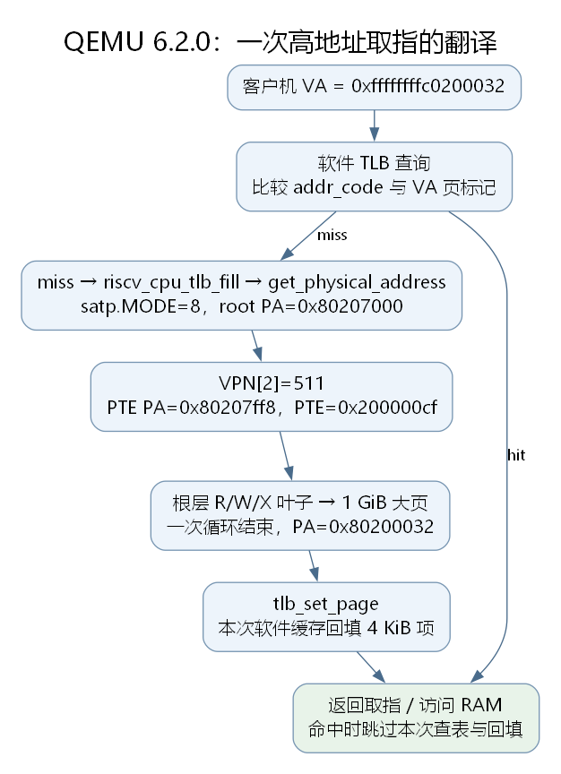

[图源](images/06-mmu.dot)对应 QEMU 6.2.0 的 `target/riscv/cpu_helper.c` 与 `accel/tcg/cputlb.c`。实际取指路径为 `cpu_exec → tb_lookup → get_page_addr_code_hostp → tlb_fill → riscv_cpu_tlb_fill → get_physical_address`，成功后回填缓存。

现场 VA=`0xffffffffc0200032`，根 PA=`0x80207000`：

```text
VPN[2] = (VA >> 30) & 0x1ff = 511
PTE_PA = root_PA + 511*8 = 0x80207ff8
PTE    = 0x200000cf
PPN    = PTE >> 10 = 0x80000
1 GiB 叶子物理基址 = 0x80000000
页内偏移 = VA & (2^30-1) = 0x00200032
PA = 0x80000000 | 0x00200032 = 0x80200032
```

`get_physical_address` 从 satp 确定三层、每层 9 位索引、PTE 8 字节，检查 VA 的符号扩展，再逐层读项。遇到 V=0、非法 W/R 组合、权限不符或大页物理地址未对齐应失败；非叶子继续下一层，合法叶子合成 PA 并返回权限。本现场在根层已经遇到合法叶子，所以循环 i=0 就结束，不补写未发生的下两层查询。


图8及下列原有调试图片，是浏览器对真实日志摘录页的截图，原日志见 [host-gdb.log](../code/evidence/qemu-mmu/host-gdb.log)，并非现场终端拍摄。日志摘录保留来源和省略标识。

#### TLB miss、fill、hit 与 Bare 对照

首次高地址取指的 `entry->addr_code=0xffffffffffffffff`，与 VA 页不匹配，进入 miss 路径。页表翻译成功后，`tlb_set_page` 收到 VA 页 `0xffffffffc0200000`、PA 页 `0x80200000`、prot=7、size=4096。**客体 PTE 为 1 GiB 叶子，但本次 QEMU 软件 TLB 回填项粒度为 4 KiB**，二者不矛盾。

后续同页取指时，缓存 tag 为 `0xffffffffc0200000`，与目标 VA 页匹配；单步从 cputlb.c 的 1506 行直接到 1523 行，跳过 miss 查询及回填。这是实际分支证据，不仅靠“断点没再响”推测命中。


Bare 对照选的是 OpenSBI 进入 S 模式内核后的低地址取指，satp=0、mmu_idx=1；`get_physical_address` 在 Bare 分支直接 PA=VA，不读取页表，但 QEMU 仍可使用软件 TLB 加速宿主 RAM 定位。它不是利用 M 模式快捷路径冒充 Bare，也不说明 RISC-V 规范要求 Bare 使用硬件 TLB。

#### 数据写入与取指路径的区别

客户机 `memset` 清 BSS 时实际执行 `sb a1,-1(a5)`，目标 VA=`0xffffffffc0208010`。宿主现场 size=1、access_type=MMU_DATA_STORE、is_debug=false，栈包含 `store_helper`，翻译得到 PA=`0x80208010`。写缓存回填基址为 VA `0xffffffffc0208000` → PA `0x80208000`。


取指路径检查 addr_code，数据写路径检查写权限对应缓存；TCG 生成代码还有快路径，并非每条访存都进入同一个 C helper。QEMU 的软件 TLB、TCG 翻译块 TB、宿主 OS 管理 QEMU 进程所用的页表，也分别属于不同层次。

#### C 的最终执行规格与结果

```text
先核对 A/B 已合并内容与分工缺项，保留唯一共享结构和地址契约。
修复分页集成后的启动断点、状态匹配、QEMU/容量传参及完成判定。
运行三后端三容量功能与启动验证；原生 GDB 调试带符号 QEMU，
客户机 GDB 对应内核实际访存，过滤 debugger 查询，保留原始日志。
逐项说明已观察的页表、权限与 TLB 分支，未触发分支不得写成已验证；
不替 A 扩充未交付的通用接口，不把自建测试称作课程评分。
```

这是对实际工作约束的整理，不虚构为事前用户逐字 prompt。集成结果和限制分别记录在 [testing.md](testing.md)、[review-ab.md](review-ab.md) 和第五节。

## 五、测试与验证

### 5.1 为什么改动 make grade，具体改了什么

**本项目需要说明的是两次不同性质的演进：从 Lab1 基础环境补充 Lab2 自测，以及 A/B 整合后让自测正确适配 Sv39。不能笼统声称“课程测试不适合，所以把它改掉”。**

Lab1 的 `grade` 调用项目自身的 `tools/verify.py`，主要验证复位、OpenSBI、入口、BSS 和 SBI 输出，不检验连续页分配。B 从基础环境补齐 Lab2 时，建立 `selftest.c + run_tests.py`，把 `make grade` 用作当前后端的正常功能检查，并保留 `grade-boot` 做启动 GDB。指导书提及的 Best-Fit 原始两个检查函数在当前基础中缺失，所以这里补充的是自建验证，不是修改原函数的断言。

随后 A 接入分页，C 在 `52ae7d0 → 328fd3a` 的集成中调整如下：

| 修改 | 修改前 | 修改后 | 合理性及补充依据 |
|---|---|---|---|
| QEMU 参数 | 部分 runner 固定调用程序名 | grade/grade-all 接收 `--qemu` | 确保 Makefile 选择的模拟器确实被使用，不改变算法预期 |
| 启动容量 | grade-boot 未传 MEMORY | QEMU 获得 `-m MEMORY` | 让宣称的 64/128/256 MiB 确实对应实际启动参数 |
| 阶段文字 | 只匹配 Bare standalone | 匹配 Sv39 integrated | 当前运行状态改变；另由 GDB 读 satp 和根表验证，不能只信文字 |
| 负面 case10 | 期待 `pa>=DRAM_BASE` | 期待 `v>=va_pa_offset` | 0x1000 在高直接映射中先被 VA guard 拒绝，保留更早的有效防线 |
| 完成条件 | 输出启动横幅即可结束 | 等 `LAB2 B SELFTESTS PASSED` | 更严格地覆盖 DTB、PMM 和 SLUB 后续执行 |
| 启动断点 | 用高链接入口等低地址执行 | 物理入口和高地址 C 入口分开 | 修正调试观察位置，不跳过分页过渡验证 |
| 集成入口 | 缺少统一矩阵及源码调试入口 | 增加 grade-integration / grade-source | 保持功能、启动、源码三类证据可分辨 |

这些差异可直接从提交比较核查：

```bash
git diff 52ae7d0 328fd3a -- lab2/code/Makefile \
  lab2/code/tools/run_tests.py lab2/code/tools/verify.py lab2/code/tools/boot.gdb
```

该命令应在仓库根目录执行。当前 `run_tests.py` 仍检查管理器、成功标记、panic、容量、管理上界及空闲页范围；没有为了 Sv39 适配删除这些功能断言。内核的 VA/PA/所有权断言也保留。

### 5.2 当前各入口到底验证什么

| 入口，工作目录 lab2/code | 实际范围 | 不应误解为 |
|---|---|---|
| `make grade` | 当前后端、当前容量的一个正常场景，含多个内核检查及 SLUB | 全部 35 场景或课程评分 |
| `make grade-all` | 9 个正常场景和 26 个预期失败场景 | 页表权限异常或源码双 GDB |
| `make grade-boot` | 单配置启动 GDB，detach 后等自测结束 | 9 组合矩阵或动态 map/unmap |
| `make grade-integration` | 35 功能 + 9 启动 GDB + 提交边界检查 | 自动包含 grade-source |
| `make grade-source` | QEMU 源码中的 Bare/Sv39/TLB/写访问现场 | 完整虚拟内存系统测试 |
| `python3 ../report/tools/capture_dtb.py` | 本次三个容量的 DTB 参数、字节、原生返回及 PMM 专项观察 | 泛化到所有设备树格式 |
| `python3 ../report/tools/check_test_sensitivity.py` | 临时副本四项故障，要求 runner 对错误实现返回失败 | 新增 4 个正常功能通过场景 |

`make` 显示 “Nothing to be done” 只说明产物已是最新；`.PHONY` 的 grade 仍会执行 runner。构建和运行判定不能混为一谈。

### 5.3 测试依据：不是只检查一行 PASS

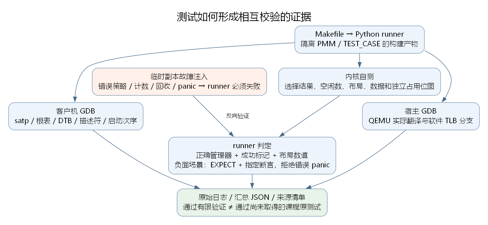

[可编辑图源](images/05-test-design.dot)。内核检查、Python runner、GDB 和故障注入检查不同层面的性质。多层检查能够减少共同遗漏，但不构成形式化证明。

| 需要成立的不变量 | 实际检查手段 | 可发现的错误 |
|---|---|---|
| 描述符与物理页一一对应 | 遍历全部描述符，核对 PA、Page、KVA 往返和 reserved 状态 | nbase/npage 混用、偏移错误、保留区泄漏 |
| 选块策略正确 | 占住其余 RAM，只留低 8 页和高 4 页，申请 3 页 | Best-Fit 仅改名、不按最小块选择 |
| 合并保持连续性 | 隔离 6 页，按 1/3/2 等顺序归还，检查块头长度及整块再申请 | 漏前合并、漏后合并、双向合并错误 |
| 分配区间不重叠 | 独立 `occupied[]` 记录每个活跃页 | 重复分配同一页或跨度重叠 |
| 计数守恒 | 每步检查 `nr_free_pages + 活跃实际跨度 = 初始总页数` | Buddy 记请求数、释放重复计数 |
| 存活数据不被破坏 | 页级每页前 32 字节标签；对象级写满请求字节并核验 | 重叠、错误回收和对象布局错误 |
| 释放可恢复资源 | 全部释放后计数恢复，隔离区可重新整块申请 | 泄漏、合并不完整或空 slab 未归还 |
| 合法 OOM 不破坏状态 | 超大请求及耗尽后的小/大对象返回 NULL | 越界分配、失败后错误扣数 |
| 非法调用在预期位置拒绝 | 独立启动 + EXPECT + 指定 panic 条件 | API 接受错误参数或在无关位置崩溃 |

位图是独立于空闲链表的记录，但随机页测试的跨度仍取自 `allocation_pages`，并非完全独立的全量参考分配器。因此又用 Buddy 边界测试独立算 `2^order` 和 PA 对齐，并用计数/数据交叉核验，不能夸大某一检查单独覆盖的范围。

### 5.4 正常场景如何覆盖策略与边界

`layout_check` 在每个正常启动中遍历全部受管 Page；`fit_check/buddy_check` 分别检查策略特性；`random_check` 使用固定种子 `0x2414067`，1200 步、64 个活跃槽位、每次 1～17 页；`slub_check` 检查 28 个请求大小及 600 个小对象，最后耗尽底层页验证 OOM。

First/Best-Fit 的“总空闲 12 页但申请 9 页失败”特别重要：可用的分别是 8 页和 4 页，保护页阻断连续性。若只看总数，错误地跨已分配页拼接也会返回非空；现在地址、位图和数据共同约束这种情况。

Buddy 的隔离测试占满所有其他页后，仅目标 8 页可用。释放 page0 和 page2 仍不能申请 2 页，释放 page1 后才形成合法伙伴块；进一步回收可以重新得到 4、8 页。这样的操作顺序检验合并关系，不只观察最终总页数。

SLUB 的 600 个 16 字节对象跨越多个 slab，释放偶数下标后重新分配，再检查奇数对象保持原内容、偶数对象保持新内容。大小测试同时覆盖 16/32/.../2048 前后边界及 2049、4096、4097、8193 等大对象，避免只检验单一规格。

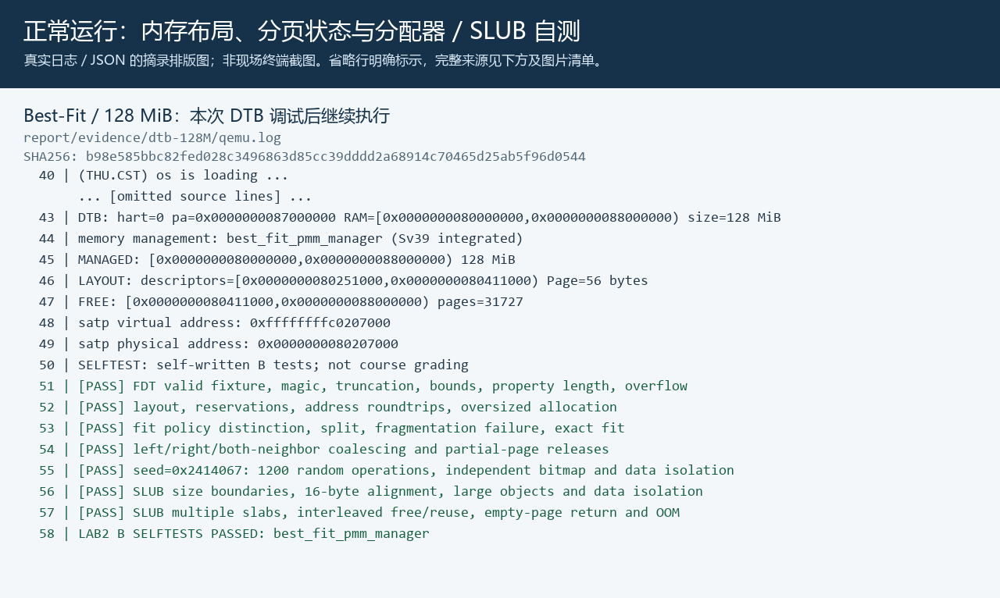

图12取自本次 DTB/128 MiB 专项运行后的 [qemu.log](evidence/dtb-128M/qemu.log)。该日志包含 DTB、布局、根表地址及全部正常自测结果，证明专项调试后内核继续执行成功。

### 5.5 负面场景及 panic 判定

负面场景不能和正常流程放在一次启动后继续跑，因为 panic 会终止正常控制流。当前通过 `TEST_CASE` 构建不同镜像，每次由 runner 启动独立 QEMU。

| case | 输入/错误 | 需要命中的检查 | 后端 |
|---|---|---|---|
| 1 | alloc_pages(0) | n>0 | 三种 |
| 2 | 释放 DRAM_BASE 保留页 | pa>=free_begin | 三种 |
| 3 | 对同一区间重复释放 | PageAllocated 检查 | 三种 |
| 4 | Buddy 请求 5 页却以 8 页释放 | requested==n | Buddy |
| 5 | kfree(对象+1) | 对象起点对齐 | 三种 |
| 6 | 重复释放对象，另一对象保持 slab 存活 | bitmap 占用位 | 三种 |
| 7 | 全零非法 FDT 夹具 | 测试端断言“解析应成功”失败 | 三种 |
| 8 | 释放数组末端之外的描述符 | index<npage-nbase | 三种 |
| 9 | 释放 Buddy 分配的内部页 | alloc_span/原始头检查 | Buddy |
| 10 | kfree((void*)0x1000) | v>=va_pa_offset | 三种 |

case7 需要特别解释：`dtb_parse` 的错误接口是返回 -1；该负面场景故意断言它返回 0，于是**测试端** panic。它证明非法夹具被解析器拒绝，不表示解析器内部所有失败路径都会 panic，也不等于完整走过真实启动 DTB 损坏后的 `dtb_init` 路径。正常 `dtb_check` 还直接检查 magic、短头、块边界、属性长度及加法溢出均返回失败。

runner 必须看见对应 `[EXPECT PANIC] label` 及预期断言，不能把任意 panic 当成功；正常场景若有 panic、缺成功标记或超时，必须失败。双重页释放允许两种后端对应的 PageAllocated 断言形式，但仍不是无条件接受任何错误。

高映射后的 case10 是合理调整的具体例子：

```text
kfree(0x1000)
  → PADDR(ptr)
  → 先检查 v >= va_pa_offset
  → 0x1000 不在高地址映射，断言立即失败
```

旧 runner 期待后面的物理下界检查，导致“内核正确拒绝，测试却误报失败”。现在只改**预期首次拒绝位置**，没有删除 guard、允许非法释放或把 panic 忽略。为验证不会误接受无关 panic，本次故障注入保留 object-outside 的 EXPECT，却改为执行 alloc_pages(0)，runner 确实以 `unexpected panic` 拒绝。

### 5.6 已有矩阵结果、证据与新补证的关系

| 验证类别 | 数量 | 结果 | 主要证据 |
|---|---|---|---|
| 正常功能 | 3 后端 × 3 容量 = 9 | 通过 | [summary-all.json](../code/evidence/selftest/summary-all.json) 与对应 case0.log |
| 预期失败 | 8 个共用 × 3 后端 + 2 个 Buddy 专有 = 26 | 命中预期拒绝 | 同目录 case1～10.log |
| 启动 GDB | 3 后端 × 3 容量 = 9 | 通过 | [integration/summary.json](../code/evidence/integration/summary.json) |
| QEMU 源码双 GDB | 独立源码现场 | 关键分支通过 | [host-gdb.log](../code/evidence/qemu-mmu/host-gdb.log)、[guest-gdb.log](../code/evidence/qemu-mmu/guest-gdb.log) |
| 本次 DTB 专项 | 64/128/256 MiB = 3 | 原生解析、独立解码、布局、自测通过 | [专项证据说明](evidence/README.md) |
| 本次故障注入 | 4 类单点错误 | 均被测试拒绝 | [test-sensitivity/summary.json](evidence/test-sensitivity/summary.json) |

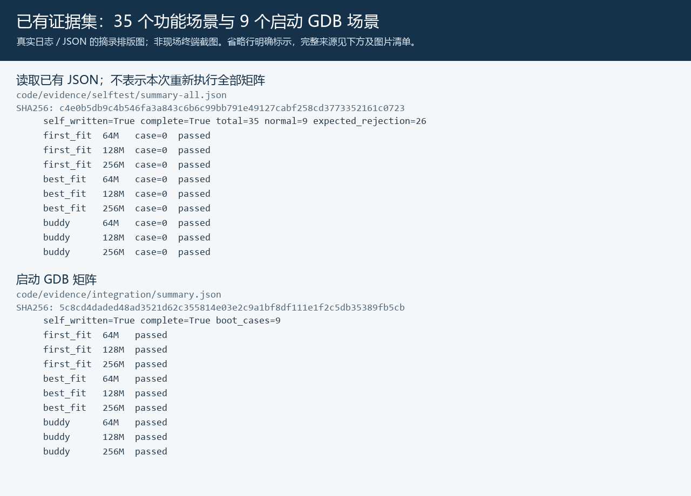

图13由两个既有 summary JSON 的实际内容排版，来源及 SHA256 保存在图片清单中。它展示证据文件内容，不伪装成 2026-10-26 重新执行完整矩阵的终端输出。本次新增执行的是 DTB 三组及故障注入四项，原有测试日志没有被这两项补证覆盖。

“35 个场景”不是 35 条内核断言：正常每场包含多个检查；“9 个 GDB 场景”也没有与 35 混算成课程得分。`make grade` 默认只运行其中一个正常组合，须 `grade-all` 或 `grade-integration` 才覆盖完整功能矩阵。

### 5.7 本次新增：测试有效性的故障注入反向验证

只展示正确实现通过，无法排除测试无论输入什么都通过。为检验测试对典型错误的敏感性，本次在 `/tmp` 临时副本中每次只改一个位置，再运行原 runner。源仓库内核和 runner 不修改；临时副本结束后清理，只保存输出和改动说明。

执行：

```bash
python3 ../report/tools/check_test_sensitivity.py
```

| 单点故障 | 预期错误行为 | 实际失败依据 | 结果 |
|---|---|---|---|
| Best-Fit 的 n,1 改成 n,0 | 名称仍 Best-Fit，实际选首块 | `selected==(pmm_manager==&best_fit_pmm_manager ? b : a)` | runner 非零退出 |
| Buddy `available-=span` 改 `-=n` | 非二次幂请求少扣页 | `nr_free_pages()==total-span` | runner 非零退出 |
| SLUB 禁止空页归还 | 对象都释放后物理页泄漏 | `nr_free_pages()==total` | runner 非零退出 |
| object-outside 改为零页申请 | EXPECT 相同但在无关断言 panic | `unexpected panic`，实际为 n>0 | runner 非零退出 |

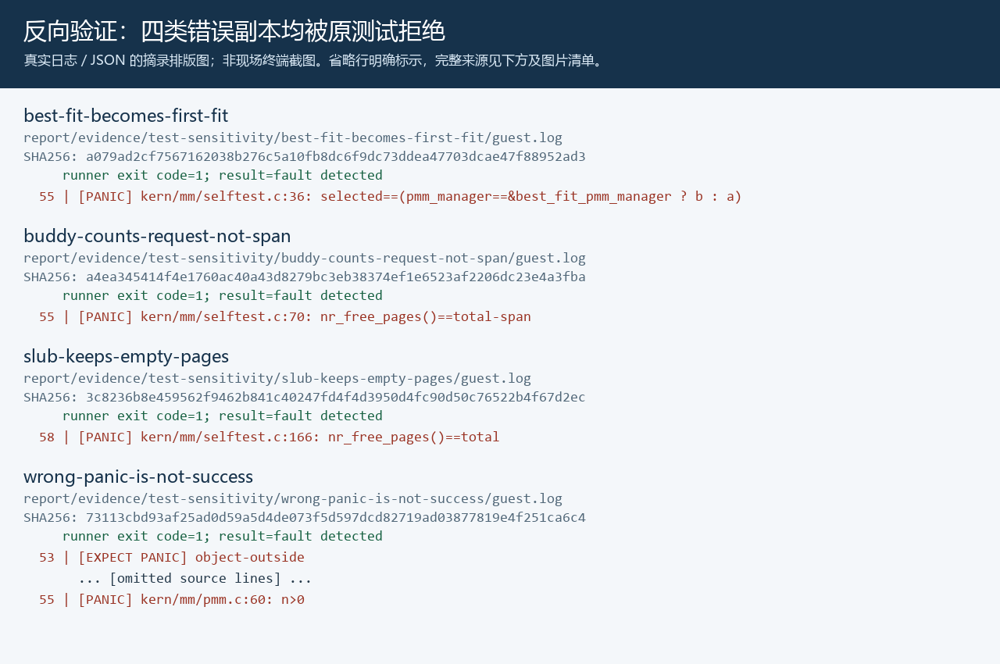

结果见 [summary.json](evidence/test-sensitivity/summary.json)，每项均有 `result.json`、runner.log、guest.log，记录原始源码 SHA256、替换前后文本、退出码与失败条件。第一项验证策略检查不是只看管理器名字；第二项验证请求/跨度区别；第三项验证回收检查；第四项验证 runner 不接受任意 panic。

这里“4/4 达到预期”表示**4 个错误副本都失败**，不是 4 个错误副本通过内核功能测试。这组实验增强了对指定检查的信心，但故障集合有限，未做全程序变异分析，也不证明所有错误都能检测。

### 5.8 测试为何合理、有效，以及仍可能遗漏什么

合理性来自规格先于实现：连续页不能跨保护页，Buddy 以实际跨度计数，对象不能重叠，资源全部释放后应恢复，非法调用和资源不足有不同接口语义。测试用独立构造、实际地址与数据验证这些性质，而不是让实现自行打印“正确”。

有效性有三层证据：正常场景中状态、计数和数据一致；指定非法调用能在预期位置被拒绝；主动注入四类错误，测试确实失败。GDB 又读取 satp、PTE、真实 DTB 和原生返回值，使单纯伪造串口名称无法满足全部证据。

仍应承认以下边界：

| 边界 | 当前未证明的内容 | 后续应怎样补 |
|---|---|---|
| 课程原测试缺失 | 兼容 basic_check/best_fit_check 的全部隐藏状态约定 | 取得原件后保持内容不变接入 |
| 随机测试有限 | 单固定种子、有限步数，不覆盖全部序列 | 多种子、多负载，并引入更独立的参考模型 |
| 页级数据仅前 32 字节 | 不能发现每页所有偏移的数据污染 | 增加页尾、随机位置及全页校验 |
| 单核、连续 RAM | 并发竞态、NUMA、任意 bank 和保留洞 | 增加平台抽象及并发机制后专门测试 |
| 启动大页只读检查 | 动态映射、撤销、权限缺页、回滚 | 先实现通用接口，再保留课程测试验证 |
| FDT 有限夹具 | 并非覆盖所有版本、token 组合和恶意 blob | 更多合法/非法夹具及有界模糊测试 |
| 输出标记参与判定 | 不是对所有潜在伪造输出的形式化防护 | 结合源码审查、独立观察和更多语义检查 |
| 既有汇总复用 | JSON 的 complete 本身不能保证对应当前源码 | 源码改变后重新全量运行，增强版本/时间绑定 |

`integration.py --boot-only` 只复用已有 `complete=true`、35 条结果，不重新运行 PMM，也不验证证据与当前所有源文件的哈希一致，因此只适合源码未变时的启动复测。第一次验收和修改代码后的验收应运行完整入口。

对指导书“不能改原有测试”的要求，当前能做出的准确陈述是：没有取得那两个原测试，也没有把它们修改成较弱版本；现有集成改动针对自建 runner 与阶段适配。**这不能证明已经满足“原测试不改且通过”的验收条件。**课程评分结论必须留待原件原样运行。

### 5.9 复现顺序与输出解释

日常快速查看：

```bash
make -j2
make qemu
# 输出完毕后 Ctrl+A，再 X 退出
make PMM=best_fit grade
make PMM=buddy grade
```

完整功能与启动验收、专项调试：

```bash
make grade-integration
make grade-source
python3 ../report/tools/capture_dtb.py
python3 ../report/tools/check_test_sensitivity.py
```

调试版 QEMU 尚未建立时，先按 4.8 节运行构建脚本。完整过程见 [操作流程.md](操作流程.md)。自测会大量分配释放 RAM，源码调试依赖特定版本行号；机器速度会影响耗时，但超时仍算失败，应查日志再判断原因。

正常场景的 `[PASS]` 和最终 `LAB2 B SELFTESTS PASSED` 对应内核检查；负面场景的 `[PANIC]` 是预期输入的拒绝，只有 runner 匹配成功才算通过。runner 清理自己创建的 QEMU 时出现 signal 15，不应单独当作内核崩溃。相反，编译成功、启动横幅或 `make` 无需重建，都不能独立证明 Lab2 功能正确。

### 5.10 图片、日志与证据来源

图1、2、3、6、7、11 是依据代码绘制的结构示意，有 DOT 源文件；图4、5、12、13、14 是对真实日志或 JSON 的排版图，不是现场终端截图；图8～10 是此前浏览器对真实 GDB 日志页的截图。三类图片在图注中分别标明。

新增图片由 [render_report_assets.py](tools/render_report_assets.py) 生成，图片来源、行号选择和 SHA256 见 [image-manifest.json](images/image-manifest.json)。图片帮助阅读，原始日志才是数值和失败条件的可追溯依据。修改内核后若地址改变，应重新采集及渲染，不能只编辑图片里的值。

在安装 Pillow、Graphviz 且带微软雅黑/Consolas 字体的 Windows 环境中，可从 `lab2/code` 重新生成新图：

```powershell
python ../report/tools/render_report_assets.py
```

脚本也支持通过可选参数调用 diagram-generator 的渲染器；默认直接使用本机 Graphviz，不依赖他人机器上的技能文件路径。原有三张 QEMU 截图不由此脚本重建，其生成过程保留在专门调试记录中。

## 六、实验总结与收获

### 6.1 对操作系统的理解：重要知识点及原理对应

| 实验知识点 | OS 原理中的含义 | 本实验中的关系和差异 |
|---|---|---|
| 固件、DTB 和内存布局 | 启动协议向内核移交硬件资源描述 | 使用 QEMU 的 FDT，不是通过访问虚拟地址空间推断真实 RAM |
| reserved、FREE 和 Page 数组 | 资源管理需区分存在、可用、已分配及元数据 | 描述符本身消耗 RAM；当前通过低端连续预留处理占用，没有任意保留洞 |
| VA、PA、PFN、Page | 地址空间、物理帧编号与内核元数据 | 固定偏移仅用于既有直接映射，Page 指针不是页内容 |
| satp 与多级页表 | MMU 根据根物理页表和权限进行地址翻译 | Sv39 最多三级，本实验根层为 1 GiB 叶子，不是每进程完整三级小页 |
| R/W/X/U/A/D | PTE 同时保存访问控制与访问状态 | 启动内核映射权限宽、U=0、A/D 预置，没有用户态保护验证 |
| TLB 与 sfence.vma | 缓存翻译及其一致性控制 | 只验证单 hart；QEMU 软件 TLB 另含宿主访问加速信息 |
| 侵入式循环链表 | 用嵌入节点组织资源，减少额外分配 | 哨兵不能转换成 Page，地址排序用于合并，不代表按大小排序 |
| First-Fit / Best-Fit | 连续资源选择策略与外部碎片 | 选块规则可区分；没有实测性能排名，二者都可能因碎片失败 |
| Buddy | 二次幂分阶、对齐与伙伴合并 | 简化拆合但引入内部碎片，请求数不同于实际占用 |
| 简化 SLUB | 在页分配上叠加对象分配，提高小对象利用率 | 没有 Linux 的并发、per-CPU、NUMA 及复杂回收机制 |
| 所有权检查与断言 | 保护内核资源状态不变量 | 非法 API 使用被拒绝；合法 OOM 返回 NULL，两者不能混淆 |
| 独立位图、数据与故障注入 | 用多种观察手段验证实现，检查测试是否敏感 | 有限反例支持可信度，不等于形式化证明或课程原评分 |

通过本实验，我们把“物理内存管理”理解为一条可检查的状态转换链：先取得可信资源边界，建立完整元数据，明确每个接口的所有权和地址语义，再维护分配/回收的不变量。分页提供访问途径，分配器提供所有权；混淆二者会产生“可以访问就可以释放”或“分到页就自动建好映射”的错误推理。

### 6.2 OS 原理很重要但本实验未覆盖的内容

| 原理 | 为什么重要 | 本实验的缺口 |
|---|---|---|
| 进程独立地址空间及用户态隔离 | 支撑进程保护和多任务 | 没有用户进程页表、用户权限及切换 |
| 动态 map/unmap、页表页分配与失败回滚 | 支撑运行中地址空间变化 | 只有启动静态映射，通用接口未交付 |
| 缺页异常与按需分页 | 将实际物理分配延后到访问时 | 未实现页故障处理和 demand paging |
| 页面置换及交换 | 物理 RAM 不足时扩展可用工作集 | 无替换算法、swap 和脏页回写 |
| COW、共享内存与映射引用计数 | 支撑高效 fork 和跨进程共享 | Page.ref 字段不等于实现完整共享/COW |
| 多核同步与 TLB shootdown | 避免页表/分配器并发状态不一致 | 单 hart，没有分配锁和跨 hart 失效 |
| NUMA、内存热插拔及多 bank | 管理真实服务器的复杂资源 | 当前连续 DRAM，固定管理上限 |
| 调度、文件系统、完整系统调用 | 把内存能力组织为可用操作系统 | 当前内核自测后空循环；SBI 输出不是用户系统调用整体设计 |

这些知识点与本章相关，但不能从“页分配成功”“SBI 能输出”推导为已经实现。当前报告把缺项单独列出，方便后续实验沿依赖关系扩充。

### 6.3 AI 协作开发的经验及迭代收获

第一，提示词要写契约。只要求“实现 Buddy”容易漏掉任意 FREE 起点、请求/跨度区别及释放语义；指定这些条件后，代码和测试才能围绕同一规格。SLUB 也需要提前确定页头开销、对齐、空页回收和 Buddy 兼容规则。

第二，测试应从错误模型出发。让 AI 同时实现和测试，可能共享同一个错误假设。隔离块、按 PA 算伙伴、独立位图、数据标签以及临时副本故障注入，分别提供不同视角，实际证明确有检查会拒绝常见错误，而非只输出成功字样。

第三，调试要明确观察层。启动 PC 的物理/链接区别解释了旧 GDB 超时；DTB 的 PA/KVA 区别解释了高映射下的解析；`is_debug` 区分客户机真实访存与调试器查询；根层叶子解释了 Sv39 提前结束。这些理解比机械复用脚本行号更重要。

第四，不能为了报告齐全而填造历史。A 的 QEMU 10.2 问题、B 的 Bare 阶段、C 的 6.2 集成和本次专项补证分别注明来源。历史材料没有精确 AI 型号、迭代次数或人工逐行复核记录时，不补写未经证实的经历；新增图也标清是示意、日志排版还是浏览器截图。

第五，修改测试必须说明理由和独立证据。把 case10 的预期从 PA guard 改为先触发的 VA guard，必须对应实际调用顺序；把 Bare 文案改为 Sv39，必须同时看到 satp.MODE=8 和根项内容。若只改匹配字符串而不验证状态，就没有充分证明实现正确。

### 6.4 整合结论与后续交付边界

当前启动、RAM 发现、描述符、三种页分配器和对象分配可以贯通运行；已有功能/启动矩阵与真实 QEMU 源码现场提供了明确证据。本次新增 DTB 专项使“启动参数→二进制 reg→原生解析返回→受管布局”可逐步复现，故障注入则为四项关键测试提供了反向验证。

后续仍应优先取得课程原测试并原样运行，明确分工中的通用页表 API 是否纳入最终交付；若纳入，应由对应模块补齐及测试。跨平台内存发现、任意保留区、动态页表和并发等未覆盖能力，不包含在当前通过结论中。

## 附录：证据索引与复现材料

| 材料 | 路径及用途 |
|---|---|
| B 的实施前提示词 | [prompt.md](prompt.md)，P1～P5，Buddy/SLUB 各含实现与测试 |
| A/B 交付核查 | [review-ab.md](review-ab.md) |
| 测试与 GDB 的原始说明 | [testing.md](testing.md)、[gdb-mmu.md](gdb-mmu.md) |
| 既有 35 场景结果 | [selftest/summary-all.json](../code/evidence/selftest/summary-all.json) |
| 既有 9 个启动 GDB 结果 | [integration/summary.json](../code/evidence/integration/summary.json) |
| DTB 本次专项 | [evidence/README.md](evidence/README.md)、[128M GDB 原始日志](evidence/dtb-128M/gdb.log) |
| 测试反向验证 | [summary.json](evidence/test-sensitivity/summary.json)、[执行脚本](tools/check_test_sensitivity.py) |
| QEMU 源码原始现场 | [host-gdb.log](../code/evidence/qemu-mmu/host-gdb.log)、[guest-gdb.log](../code/evidence/qemu-mmu/guest-gdb.log) |
| 图片生成与来源 | [render_report_assets.py](tools/render_report_assets.py)、[image-manifest.json](images/image-manifest.json) |
| 完整实操步骤 | [操作流程.md](操作流程.md) |
| 问题导向答辩材料 | [答辩速记.md](答辩速记.md)、[详细知识点](答辩知识点.md) |
| AI 及提交边界记录 | [ai-collaboration.md](ai-collaboration.md)、[submission-check.json](submission-check.json) |

本报告为 Markdown 文本主稿，图片与脚本均使用相对路径，便于本地和 GitHub 一起查看。离线指导书及其压缩包继续不纳入上传范围。
